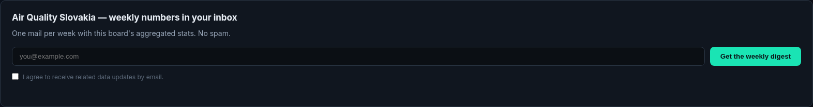

# LE Digest — Subscriptions and Reports

A site can offer useful information without making readers repeatedly return to every tool to check for changes. LE Digest connects topic subscriptions, downloadable resources and recurring reports in a WordPress experience, helping readers follow the subjects they chose.

## Tech stack

| Layer | Technologies |
|---|---|
| Core stack | PHP; WordPress; Python; SQLite |

## Subscribe to a relevant topic

Readers subscribe with their email address from a form on a tool or article page. The form is protected by a hidden honeypot field and a limit of five sign-ups per hour per IP address, requires consent, and uses double opt-in: the subscription stays pending until the reader clicks the confirmation link in the first email. Nine topics (digest lists) exist, among them the data tools of the site, the spread monitor, the satellite-TV tools and the WSL guides, and a sign-up inherits the topic of the page or download that prompted it.

Subscriptions begin in the context of the page that prompted them. That makes the topic and expected communication understandable before the reader confirms their interest.

## Offer a useful download

A download offer (a lead magnet) is placed with the `[le_magnet]` shortcode. After confirming, the reader receives a mail with a personal link; the files live in a protected folder and are served only through the plugin, so they cannot be fetched by guessing a URL. Existing subscribers who request another download get it immediately without confirming again. Some packs are rebuilt automatically from the site's own data and uploaded to the plugin.

The resource journey keeps the promised material connected to the subscription. It is useful for a site offering a focused download alongside an article or application.

## Turn observations into readable reports

A weekly digest is sent on Mondays for each topic. Its content comes from the topic's own data history: for example new exploited vulnerabilities and the highest severity scores, the highest funding rates and largest open interest, the week's launches and the next ones, unique aircraft per category, the worst air-quality readings, papers per week and busiest categories, and the widest exchange gaps. Mails use a branded HTML layout with a plain-text alternative, and a report is not sent if its data could not be read completely.

A useful report helps the reader understand the period and subject before interpreting individual observations. The digest connects recurring information with the tools where it can be explored further.

## Manage the subscriber relationship

Every mail carries an unsubscribe link and a subscriber moves from pending to active to unsubscribed. The administration page lists topics with their active subscribers and downloads, the downloads with slug, title, file and size, and the subscribers with email, topics, status and the dates of sign-up and confirmation, with a CSV export.

Audience administration and reader choices belong together. Topic grouping supports relevant communication, while the unsubscribe path lets readers manage continued participation.

## Maintain the publishing routine

A delivery ledger lists the most recent digests with topic, creation time, status and number of recipients, so the operator can see whether a weekly send went out. Each report links back to the tool it describes.

The operator can maintain resources and recurring communication from a familiar WordPress workflow. This keeps the publishing routine connected to the site's content rather than a separate manual exchange.

---

Private code: [le-digest-plugin](https://github.com/logicencoder/le-digest-plugin)

See [REPOS.md](REPOS.md) for related repositories.

**[Logic Encoder](https://logicencoder.com)** · [GitHub](https://github.com/logicencoder) · [Contact](https://logicencoder.com/contact/)
