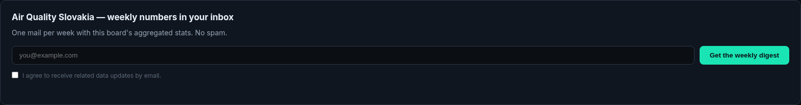

# LE Digest — Subscriptions and Reports

A site can offer useful information without making readers repeatedly return to every tool to check for changes. LE Digest connects topic subscriptions, downloadable resources and recurring reports in a WordPress experience, helping readers follow the subjects they chose.

## Tech stack

| Layer | Technologies |
|---|---|
| Core stack | PHP; WordPress; Python; SQLite |

## Subscribe to a relevant topic

Readers can subscribe through forms associated with a tool or article. Confirmation gives them a clear next step before receiving the corresponding communication. Topic selection keeps the subscription connected to the information that interested the reader.

Subscriptions begin in the context of the page that prompted them. That makes the topic and expected communication understandable before the reader confirms their interest.

## Offer a useful download

The downloadable-resource experience connects a subscription with the intended material. Readers receive an access path associated with that resource rather than having to request it manually. Site owners maintain the available resources in administration.

The resource journey keeps the promised material connected to the subscription. It is useful for a site offering a focused download alongside an article or application.

## Turn observations into readable reports

Recurring digests bring supported source information into a report with context, periods and relevant comparisons. Headings and readable sections help the recipient understand what the report covers. Coverage limitations matter when a source does not provide a complete period.

A useful report helps the reader understand the period and subject before interpreting individual observations. The digest connects recurring information with the tools where it can be explored further.

## Manage the subscriber relationship

Every message provides an unsubscribe route so readers can change their choice. Subscriber administration and CSV export help the owner maintain the audience, while topic grouping supports relevant distribution. The focus is on a coherent subscription journey rather than a detached mailing list.

Audience administration and reader choices belong together. Topic grouping supports relevant communication, while the unsubscribe path lets readers manage continued participation.

## Maintain the publishing routine

Resource management and delivery-related administration keep the recurring communication visible to the operator. Reports link back to the related applications when a reader wants more detail. This helps connect discovery, ongoing interest and the site's working tools.

The operator can maintain resources and recurring communication from a familiar WordPress workflow. This keeps the publishing routine connected to the site's content rather than a separate manual exchange.

---

Private code: [le-digest-plugin](https://github.com/logicencoder/le-digest-plugin)

See [REPOS.md](REPOS.md) for related repositories.

**[Logic Encoder](https://logicencoder.com)** · [GitHub](https://github.com/logicencoder) · [Contact](https://logicencoder.com/contact/)
